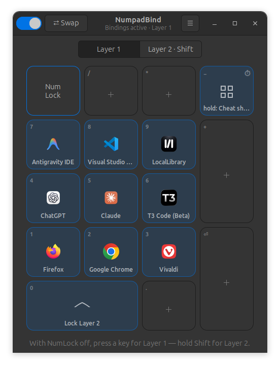
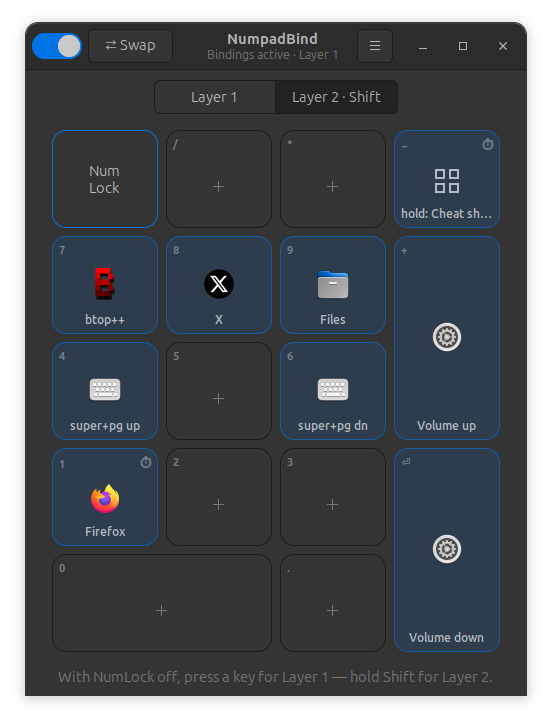
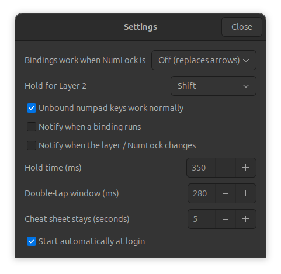
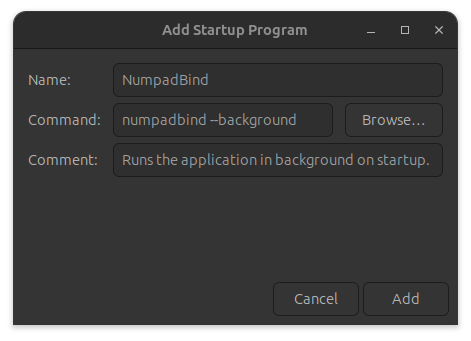

# NumpadBind


<p align="center">
  
</p>

---

Bind apps, scripts and system actions to your numpad on Linux. NumLock **off** turns the numpad into a launcher with **two layers** (NumLock on keeps the normal digits): press a key for Layer 1, hold a modifier (Shift by default) for Layer 2. Works on X11 and Wayland, and finds apps installed with apt, Snap, Flatpak and AppImage.
 
## Features
 
- Click a numpad key in the window to bind it; live key flash when a binding fires
- Two layers, with a configurable Layer 2 modifier (Shift, Ctrl, Alt, AltGr, Right Ctrl, Super) and a "Lock Layer 2" toggle key
- Apps from apt, Snap, Flatpak and AppImage, with a searchable picker that shows where each app came from
- Three actions per key: **tap**, **hold** and **double-tap**
- Cheat-sheet overlay showing what every key does right now (bind it to a Hold, or open it from the tray)
- Action types: application, command or script (optionally in a terminal), URL / file / folder, send keystrokes, system actions, Layer 2 lock
- System actions: volume up/down, mute, mic mute, play/pause, next/previous track, brightness up/down, screenshot (sent as real media keys, so your desktop shows its normal on-screen display), plus lock screen, suspend and dark-mode toggle
- Tray icon in the top bar: bright = active, orange corner = Layer 2, dim = bindings inactive (NumLock in the other state) or paused. Closing the window hides it to the tray
- Unbound numpad keys keep working normally (switchable)
- Failed commands show a notification with the error instead of failing silently
- Optional notifications, start at login, JSON import / export

## Application Look:




## Requirements
 
| | |
|---|---|
| OS | Ubuntu 22.04 or newer (or another Debian-based distro with GNOME) |
| Session | X11 or Wayland |
| Python | 3.10+ (the system `/usr/bin/python3`, not conda or pyenv) |
| Keyboard | Must send real keypad keycodes (`KEY_KP0`…`KEY_KP9`). Check with `sudo evtest` |
| Privileges | `sudo` once, to install packages and a udev rule |
 
### Packages
 
Installed automatically by `scripts/install.sh`:
 
| Package (apt) | Purpose | Required |
|---|---|---|
| `python3-gi`, `gir1.2-gtk-3.0` | Window and dialogs (GTK 3) | Yes |
| `python3-evdev` | Reading keyboards and passing keys through | Yes |
| `python3-venv` | Per-user install environment | Yes |
| `gir1.2-ayatanaappindicator3-0.1` | Tray icon | Yes (tray) |
| `libnotify-bin` | Notifications (`notify-send`) | Recommended |
| `wmctrl` | "Raise window if already running" on X11 | Optional |
| `playerctl` | Spare media control for your own commands | Optional |
 
Python packages (pip): `evdev>=1.6`. PyGObject comes from apt, because pip builds of it need many system headers. For development, add `pytest` and `pyflakes`.
 
On GNOME the tray icon needs the AppIndicator extension. Ubuntu enables it by default; on other distros install `gnome-shell-extension-appindicator`.
 
## Install
 
```bash
unzip numpadbind.zip && cd numpadbind
./scripts/install.sh
numpadbind
```
 
No re-login is needed. If the app was already running, quit it first (tray icon → Quit, or `pkill -f numpadbind`).
 
### What the installer does
 
1. Installs the apt packages above.
2. Installs `/etc/udev/rules.d/70-numpadbind.rules`, which gives your logged-in desktop session access to keyboards and `/dev/uinput` (via the `uaccess` tag), and loads the `uinput` kernel module at boot.
3. Adds you to the `input` group as a fallback.
4. Creates a virtual environment at `~/.local/share/numpadbind/venv` built on `/usr/bin/python3` with system site-packages, and installs the app into it.
5. Installs a launcher at `~/.local/bin/numpadbind` (it clears variables that snap-packaged terminals such as the VS Code snap leak) and a desktop entry, so NumpadBind appears in your app menu.
### Manual install
 
```bash
sudo apt install python3-gi python3-evdev python3-venv gir1.2-gtk-3.0 \
  gir1.2-ayatanaappindicator3-0.1 libnotify-bin wmctrl
sudo install -m644 packaging/70-numpadbind.rules /etc/udev/rules.d/
echo uinput | sudo tee /etc/modules-load.d/numpadbind.conf
sudo modprobe uinput && sudo udevadm control --reload && sudo udevadm trigger
/usr/bin/python3 -m venv --system-site-packages ~/.local/share/numpadbind/venv
~/.local/share/numpadbind/venv/bin/pip install .
install -m755 packaging/numpadbind-launcher.sh ~/.local/bin/numpadbind
```
 
Make sure `~/.local/bin` is on your `PATH`. Verify access with `ls -l /dev/uinput`: the permissions should end in `+` (for example `crw-rw----+`).
 
### Run from source
 
```bash
make run        # PYTHONPATH=src python3 -m numpadbind
```
 
## Usage
 
1. Turn **NumLock off**. Bindings replace the arrow/Home/End behaviour; with NumLock on the numpad types digits as usual. Prefer the opposite? *Settings → Bindings work when NumLock is → On*.
2. Click a key in the window, pick a type (for example *Application*), choose the target and press **Save**. **Test** runs it immediately.
3. Press the key on your keyboard to run it.
**Layer 2:** click the **Layer 2** tab above the numpad and bind keys the same way. Hold your Layer 2 modifier (Shift by default) and press the key. Change the modifier in *menu → Settings*.
 
**Tap, hold and double-tap:** the key editor has three tabs. *Tap* is a quick press, *Hold* runs when you keep the key down (0.35 s by default), and *Double-tap* runs when you press twice quickly. Keys with only a Tap action fire instantly. If a key also has Hold or Double-tap, its tap waits a moment: until you release it (Hold) or until the double-tap window passes (Double-tap). Times are adjustable in Settings. Keys with extra actions show ⏱ and ×2 badges.
 
**Cheat sheet:** bind *Show cheat sheet* to a key (a **Hold** action on a key like 5 works well) or pick it from the tray menu. A translucent numpad pops up with the current layer's bindings, and follows you if you hold the Layer 2 modifier. It closes after a few seconds (Settings), when you click it, or when you press a bound key.
 
**Swap layers:** the **⇄ Swap** button in the title bar gives Layer 1 the bindings of Layer 2 and the other way round. Press it again to undo.
 
**Lock Layer 2:** bind any key in Layer 1 to *Lock Layer 2 on / off*. Press it to stay on Layer 2 without holding a modifier, and press it again to switch back. Keys with no Layer 2 binding behave as normal numbers while it is locked.
 
**Keystrokes:** enter combos like `ctrl+alt+t`, `super+d` or `volumeup`. Your Layer 2 modifier is still physically held while a combo fires.

**Create a startup:** you use the automatic startup of the application using the `menu → Settings → start automatically at login` or you use the app `Startup Application` in Ubuntu to run a startup command for this app.

```bash
numpadbind --background
```



 
Configuration is stored in `~/.config/numpadbind/config.json`. Run `numpadbind --background` to start in the tray without a window.
 
## Custom icon
 
Put your icon in `assets/` as `numpadbind.svg` and/or `numpadbind.png` (any other `.svg` / `.png` name also works if those are missing; a PNG of 256px or larger is best). Their are some other options available in `assets/other options`. `./scripts/install.sh` installs it into your icon theme (`~/.local/share/icons/hicolor`), and NumpadBind uses it for the app menu, dock and window. The top-bar tray icon stays the built-in numpad-grid icon, so its states stay easy to read: bright when bindings are active, faded when inactive or paused, with an orange corner on Layer 2. After changing the icon, re-run the installer and restart the app (log out and in if the dock still shows the old one).
 
## Troubleshooting
 
| Symptom | Fix |
|---|---|
| Banner: "No access to keyboards" | Run `ls -l /dev/uinput` (should end in `+`). Re-run `./scripts/install.sh`, or log out and back in once. Don't start the app with `sg input`: it breaks Flatpak launches (`bwrap: Can't find source path /run/user/1000/doc/…`) |
| Old banner after fixing permissions | Closing the window only hides it. Quit from the tray (or `pkill -f numpadbind`) and start again |
| `ModuleNotFoundError: No module named 'gi'` | The venv was built on a non-system Python. Re-run `./scripts/install.sh`, which rebuilds it on `/usr/bin/python3` |
| `GLIBCXX not found`, `GLIBC_PRIVATE`, or `snap/core20` errors | You started it from a snap app's terminal (VS Code snap). Use the installed launcher (`install -m755 packaging/numpadbind-launcher.sh ~/.local/bin/numpadbind`) or a normal terminal |
| No tray icon | Enable the AppIndicator extension (on by default in Ubuntu); check `gir1.2-ayatanaappindicator3-0.1` is installed |
| Keys do nothing | NumLock must be in the state chosen in Settings (default: off), and the app must be enabled (switch in the title bar). Check that your keyboard sends keypad keycodes with `sudo evtest` |
| Layer 2 does nothing with Shift | Some laptop firmwares send different codes with Shift held. Switch the modifier in Settings, or use the Lock Layer 2 key |
| Bindings fire in the wrong NumLock state | Quit the app, run `numpadbind --debug` in a terminal and press a key: each press prints the detected NumLock state. `numpadbind --diagnose` (app running) shows how NumLock is detected; run it with NumLock on and off and compare |
| Doesn't start at login | Open Settings and tick *Start automatically at login* (it now verifies the entry and reports errors). Then check `cat ~/.config/autostart/numpadbind.desktop` and, after logging in, `cat ~/.local/state/numpadbind/numpadbind.log` (the launcher logs login starts there). `numpadbind --diagnose` also shows the autostart state. Re-run `./scripts/install.sh` first so the launcher with logging is installed |
| Typing feels laggy | First rule the app out: **Quit** it from the tray (the *Enabled* switch still forwards every key, only Quit releases the keyboard) and type for a minute. If the lag stays, it isn't NumpadBind. If it goes away, run `numpadbind --debug`: any key the app held for more than 15 ms prints `slow: key event waited N ms`. `top` while typing shows whether `gnome-shell` or NumpadBind is busy |
| A command fails | A notification shows the exit code and error. Test the command in a terminal first |
 
## How it works
 
`engine.py` grabs every keyboard that has a keypad through evdev. While bindings are active (NumLock off by default), a bound numpad key is swallowed and its action runs; every other key is re-emitted unchanged through a virtual uinput keyboard. Because this happens below the display server, it works on Wayland and X11 alike. System actions and keystroke bindings are sent back through a virtual keyboard as ordinary key events.
 
**Security note:** anything that can read `/dev/input` can see all keystrokes. The udev rule limits access to your logged-in desktop user, but only install NumpadBind on machines you trust.
 
## Project layout
 
```
src/numpadbind/
  engine.py      key grabbing and forwarding (no GUI dependencies, unit-tested)
  actions.py     runs a binding
  app.py         Gtk.Application wiring
  tray.py        status-area indicator and icons
  apps.py        .desktop-file helpers
  config.py      JSON config load / save
  constants.py   keys, modifiers, system actions, paths
  gi_setup.py    PyGObject setup (Flatpak / Snap launcher paths)
  autostart.py   start-at-login entry
  icons.py       custom app icon (window, dock, app menu)
  ui/overlay.py  cheat-sheet overlay
  ui/            window, numpad grid, editor, app picker, settings, CSS
assets/          your app icon (svg / png)
packaging/       udev rule, uinput module list, desktop entry, launcher
scripts/         install.sh, uninstall.sh
tests/           pytest suite
```
 
## Development
 
```bash
make run     # run from source
make test    # needs python3-evdev and pytest
make lint    # needs pyflakes
```
 
The tests cover the config, the key-combo parser and the engine's layer, passthrough, pause and lock logic with fake devices; the GTK interface is not covered by automated tests.
 
## Uninstall
 
```bash
./scripts/uninstall.sh
```
 
This removes the app, launcher, desktop and autostart entries, and the udev rule. Your bindings stay in `~/.config/numpadbind` until you delete that folder. To drop the group fallback: `sudo gpasswd -d $USER input`.
 
## License
 
MIT. See [LICENSE](LICENSE).
 